A scrapbook of good intentions in UX design.

This isn’t meant to be a comprehensive guide to anything; it’s a scrapbook and a journal at best, capturing the points I kept in mind while developing Askare and Lappu, two Nextcloud Tasks and Notes clients that share a lot of common ground. For obvious reasons, this piece focuses on my experience with Sailfish OS apps, though most of these ideas apply generally. It’s just a chronicle of my first steps into the topic, so feel free to correct me or suggest interesting reads.

At the end of the day, I hope this proves useful — or at the very least, an interesting read — for the (vibe) coders out there, both seasoned and fresh.

## A decade-old itch

I am no developer, and I’m no UI designer either. Half of my workday is spent in a terminal, so there’s no obvious reason I should care about UIs and UX as much as I do.

Yet it is an inherently fascinating topic. When you open an app on your phone, what makes it feel effortless or clunky? How can an interface subtly guide — or misguide (see dark patterns[^1]) — your decisions?

I started pondering this while dipping my toes into barebones app development. When I first worked on UI Themer ten years ago, I was intuitively never satisfied with how the app turned out, even if I couldn't articulate why.

Now that LLMs handle the boilerplate I used to dread, I finally had the headspace to revisit those projects and fix the UX mistakes I'd been making for ten years.

## One size doesn’t fit them all

As AI democratizes app development (I’ll leave the rightful controversies aside, as they aren't what this post is about), Sailfish OS has seen an influx of new native apps of varying quality.

Because Sailfish is a small platform with a limited pool of training data, AI-assisted apps naturally lean heavily on Android or iOS conventions. On one hand, this is a great opportunity to widen the selection of native apps, something every niche platform struggles with. On the other, in the right hands, it’s a chance to go beyond generic mobile patterns and honor what Sailfish users actually expect when interacting with an app.

## Vibe-coding and zen detaching, aka don’t design the app you develop

Vibe-coding seems to be the buzzword of the moment, though in reality, nobody ever wanted to scaffold, write boilerplate, or document their code.

I decided it was time to give AI agents a go. UI Themer was a truly awful mess of C++ calling a series of bash scripts. It worked, but I hated touching it and never really got around to studying C++. What if I could port those bash scripts to C++ one function at a time with the help of a model? Without going into too much detail, it wasn’t as simple as *code this app, make no mistakes* but, slowly, that process abstracted me from the inner workings of my own code, and I started noticing something important:

### What makes sense to you doesn’t make sense to the user

UI Themer started around the concept of themes: a single package containing icons and fonts that could be applied together. Since they were conceived as a bundle, putting "Themes" as the primary option made total sense to me.

Later on, a [display density] option came along, letting users adjust the DPR and DPI of their phone. Because it was added later, where did it go? Tucked into a secondary tab, behind the main content.

Without realizing it, I had imposed a hierarchy on my features — and it was completely arbitrary and chronological. In UX terms, I had built the interface around my own implementation model rather than the user's *mental model*[^2]. I had never stopped to ask: *“Why does the user open the app? What do they actually want to do?”*

<figure style="display: flex; flex-wrap: wrap; justify-content: center; gap: 10px; margin: 1.5em auto; width: 100%;">
  <a href="../../../assets/posts/2026/11/uithemer-tab-ui.png" style="flex: 1 1 220px; max-width: 280px; text-decoration: none;">
    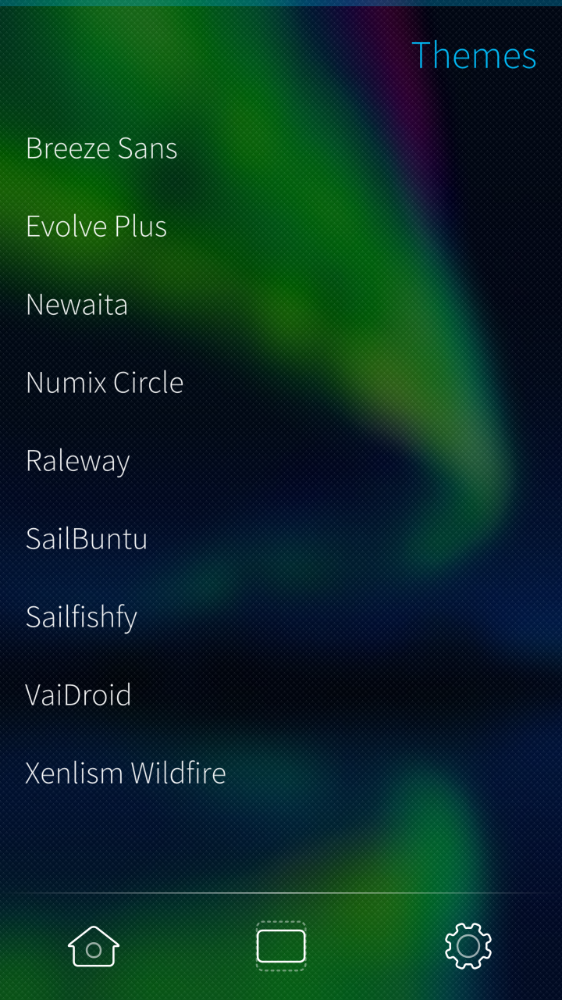
  </a>
  <a href="../../../assets/posts/2026/11/muoto-tile-ui.png" style="flex: 1 1 220px; max-width: 280px; text-decoration: none;">
    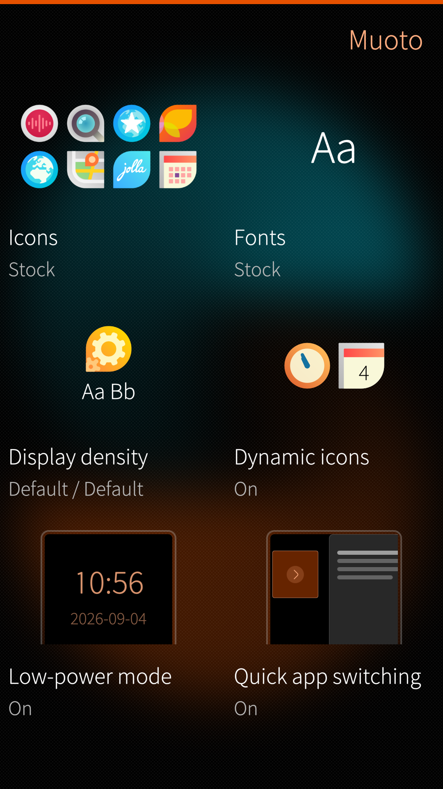
  </a>
  <figcaption style="flex-basis: 100%; font-size: 0.85em; color: #666; text-align: center; margin-top: 0.5em;">
    Old tabbed UI in UI Themer vs. new tile UI in Muoto (its successor)
  </figcaption>
</figure>

Once I stopped stressing over missing types in a C++ class, I started thinking about the app's actual workflows, from the moment you open it to the moment you close it.

You don’t necessarily want to apply an entire theme. You might only want to change the font or the display density, so who am I to decide those features are secondary? In the redesign (which became Muoto), changing fonts went from *Open the app -> browse themes -> find a theme with fonts* to *Open the app -> select Fonts -> pick a font*. Looking for display density instead? It’s right there on the main screen; you can ignore icons and fonts completely.

<figure style="display: flex; flex-wrap: wrap; justify-content: center; gap: 10px; margin: 1.5em auto; width: 100%;">
  <a href="../../../assets/posts/2026/11/uithemer-fonts.png" style="flex: 1 1 220px; max-width: 280px; text-decoration: none;">
    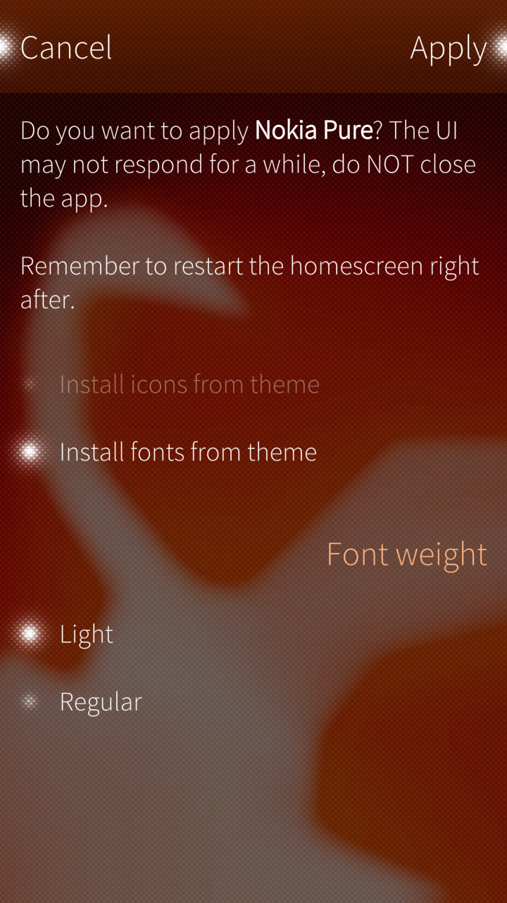
  </a>
  <a href="../../../assets/posts/2026/11/muoto-fonts.png" style="flex: 1 1 220px; max-width: 280px; text-decoration: none;">
    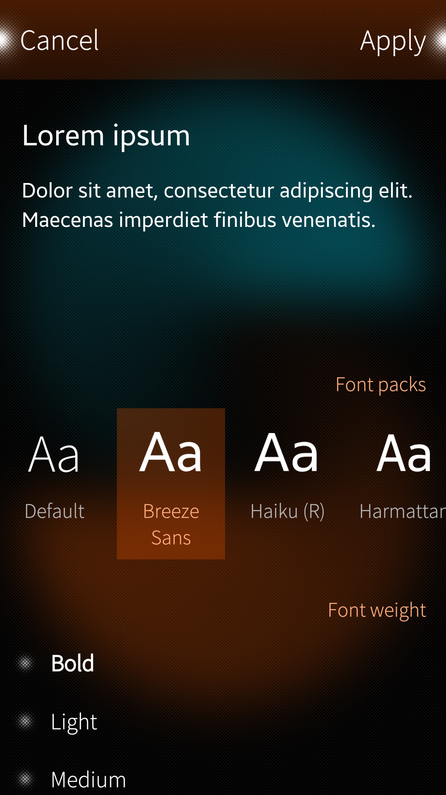
  </a>
  <figcaption style="flex-basis: 100%; font-size: 0.85em; color: #666; text-align: center; margin-top: 0.5em;">
    Old vs. new font workflow
  </figcaption>
</figure>

Using the same principle, I overhauled My Data Transfer (now Talteen). The app has three main jobs: creating a backup, restoring a backup, and sending or receiving one. Here too, the hierarchy had been purely chronological: the first screen offered backup creation, restoring sat in a second tab, and send/receive was tacked onto the last tab.

At this point, I grabbed pen and paper and mapped out the real user journeys:
- Create a backup and optionally send it to another device.
- Send a backup I already created.
- Restore a backup I already created.
- Receive a backup from another device and optionally restore it.

My goal shifted to a simple question: *Which layout minimizes the interactions needed for any of these tasks?*

<figure style="display: flex; flex-wrap: wrap; justify-content: center; gap: 10px; margin: 1.5em auto; width: 100%;">
  <a href="../../../assets/posts/2026/11/mdt-backup.png" style="flex: 1 1 220px; max-width: 280px; text-decoration: none;">
    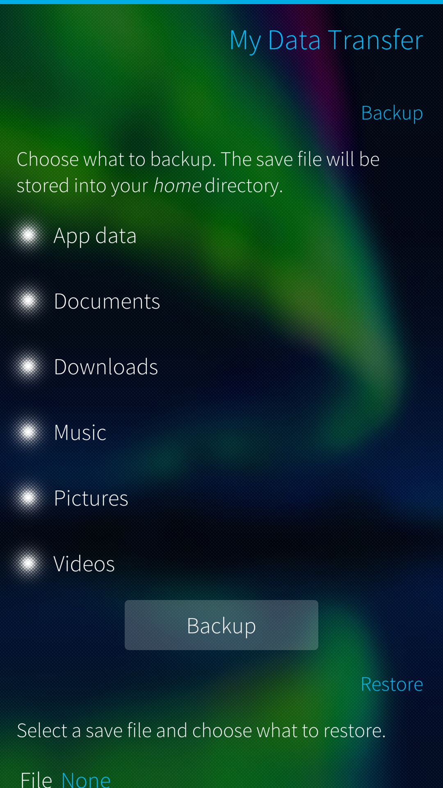
  </a>
  <a href="../../../assets/posts/2026/11/talteen-main.png" style="flex: 1 1 220px; max-width: 280px; text-decoration: none;">
    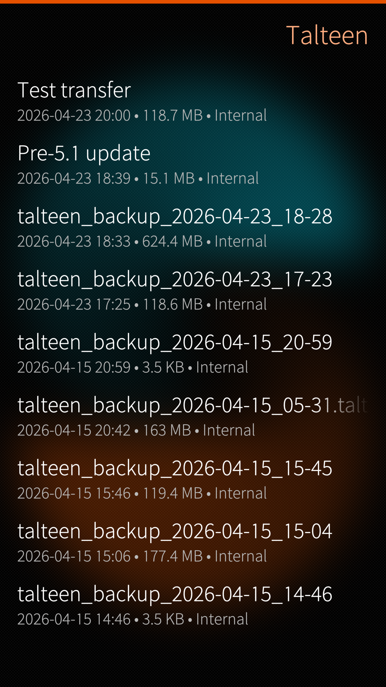
  </a>
  <figcaption style="flex-basis: 100%; font-size: 0.85em; color: #666; text-align: center; margin-top: 0.5em;">
    Old vs. new main screen in My Data Transfer / Talteen
  </figcaption>
</figure>

Creating a backup now takes one extra gesture (pulling down the pulley menu), so it is no longer forced on you as the default path. Instead, the app opens directly to your list of existing backups, making restoring or sending one immediate, without switching tabs or hunting through the file system. Receiving and restoring a backup from another device, which used to mean jumping through multiple hoops, now happens in a single seamless flow.

### Focus

Decide what you want to build, and let that be your anchor. For Askare and Lappu, I wanted an experience as close as possible to what Nextcloud offers natively. That doesn’t rule out exclusive features, but it keeps me from turning the apps into something else entirely. And if someone ever asks you to turn your note-taking app into a full Office suite...

### Learn to say no

A button that turns a document into a GIF. A lunar calendar for an email client. Users will always find unexpected ways to use your app, so don't lose sight of why you made it in the first place. A feature-bloated app is also a pain to maintain, unless you have a community of contributors sending PRs and reviewing code, *Keep It Simple, Sunshine*.

### RTFG (Read the Fantastic Guidelines)

LLMs are great at pumping out code, yet still clumsy with platform-specific interaction nuances. This is where you make the difference. Immerse yourself in the [guidelines] and build a coherent workflow so users feel at home rather than lost, especially on their first launch.

For Askare and Lappu, I leaned heavily on Sailfish documentation, including their very useful [common pitfalls page].

When your app has many options, keep them distinct and scannable. Information overload is real: show only what is relevant and group related controls into clean sections.

<figure style="display: flex; flex-wrap: wrap; justify-content: center; gap: 10px; margin: 1.5em auto; width: 100%;">
  <a href="../../../assets/posts/2026/11/askare-old-details.png" style="flex: 1 1 220px; max-width: 280px; text-decoration: none;">
    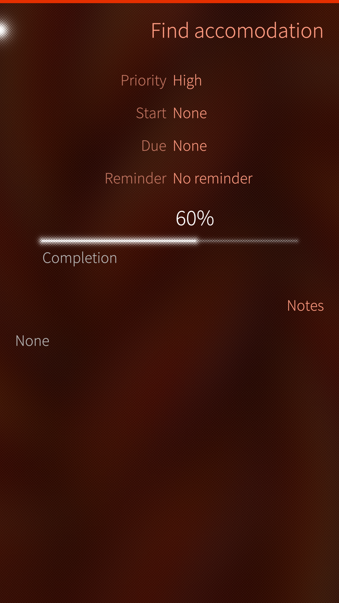
  </a>
  <a href="../../../assets/posts/2026/11/askare-new-details.png" style="flex: 1 1 220px; max-width: 280px; text-decoration: none;">
    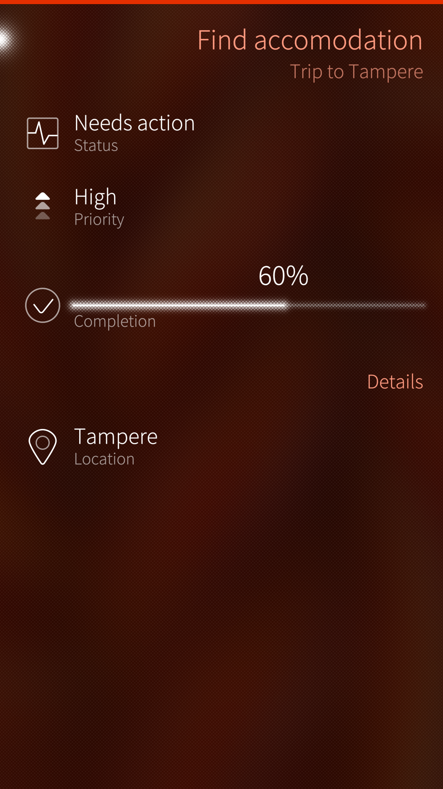
  </a>
  <figcaption style="flex-basis: 100%; font-size: 0.85em; color: #666; text-align: center; margin-top: 0.5em;">
    Old vs. new Askare task details
  </figcaption>
</figure>

In my first draft, I tried maximizing information density. Everything fit neatly onto half a screen, but your eyes had to work overtime just to parse it, a real problem on a mobile device meant to be used on the move.

What I landed on instead is a bit of progressive disclosure that maximizes the *signal-to-noise ratio*[^3]: showing only the fields that are actually populated — because “No notes” is pure noise — divided into clean sections with descriptive icons.

### Consistency is key

The same icons, dividers, and ordering should appear predictably across the app, and any exception should be clearly communicated.

(The one deliberate exception in Askare is the Priority layout, due to Nextcloud constraints that pair numeric values with named priority levels. When creating a task, you may want granular control; when viewing it later, you just want a quick sense of urgency.)

<figure style="display: flex; flex-wrap: wrap; justify-content: center; gap: 10px; margin: 1.5em auto; width: 100%;">
  <a href="../../../assets/posts/2026/11/askare-single-selection.png" style="flex: 1 1 220px; max-width: 280px; text-decoration: none;">
    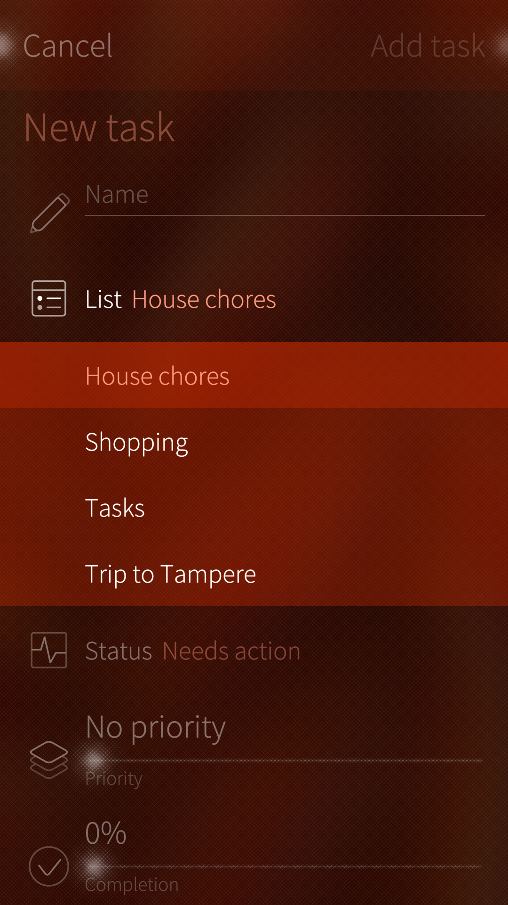
  </a>
  <a href="../../../assets/posts/2026/11/askare-multi-selection.png" style="flex: 1 1 220px; max-width: 280px; text-decoration: none;">
    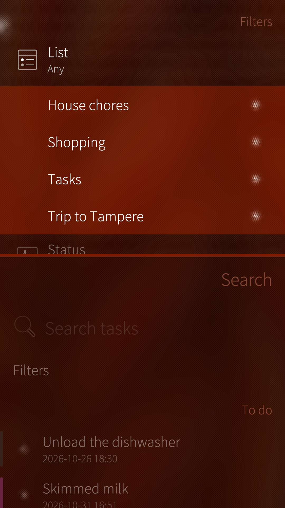
  </a>
  <figcaption style="flex-basis: 100%; font-size: 0.85em; color: #666; text-align: center; margin-top: 0.5em;">
    Same ordering, same padding. The IconSwitch, typically on the left in Sailfish, is moved to the right to preserve a consistent layout.
  </figcaption>
</figure>

Sailfish also provides the `AttachedPage`, which I use for what feels like its most natural role: switching the main content view. Whenever you want to jump to another list, category, or tag, you know you can always swipe right and get the exact same behavior.

<figure style="display: flex; flex-wrap: wrap; justify-content: center; gap: 10px; margin: 1.5em auto; width: 100%;">
  <a href="../../../assets/posts/2026/11/askare-attachedpage.png" style="flex: 1 1 220px; max-width: 280px; text-decoration: none;">
    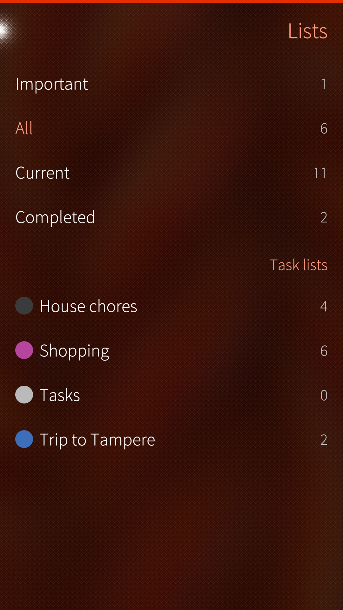
  </a>
  <a href="../../../assets/posts/2026/11/lappu-attachedpage.png" style="flex: 1 1 220px; max-width: 280px; text-decoration: none;">
    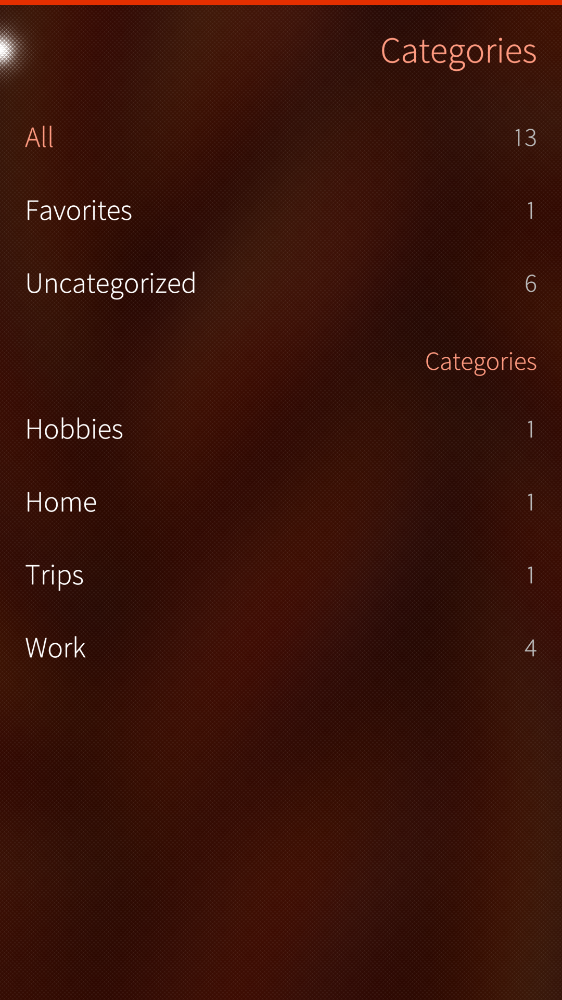
  </a>
  <figcaption style="flex-basis: 100%; font-size: 0.85em; color: #666; text-align: center; margin-top: 0.5em;">
    Askare vs. Lappu AttachedPage
  </figcaption>
</figure>

### Make feature requests truly yours

Recently, someone asked me to add dedicated sections for high-priority and upcoming tasks. That raised an immediate question: *What counts as "upcoming"?* What if the next person wants tasks between 43% and 71% completion? Trying to hardcode every hyper-specific preference is a losing game.

What if, instead, users could define what matters to them?

<figure style="display: flex; flex-wrap: wrap; justify-content: center; gap: 10px; margin: 1.5em auto; width: 100%;">
  <a href="../../../assets/posts/2026/11/askare-filter-ui.png" style="flex: 1 1 220px; max-width: 280px; text-decoration: none;">
    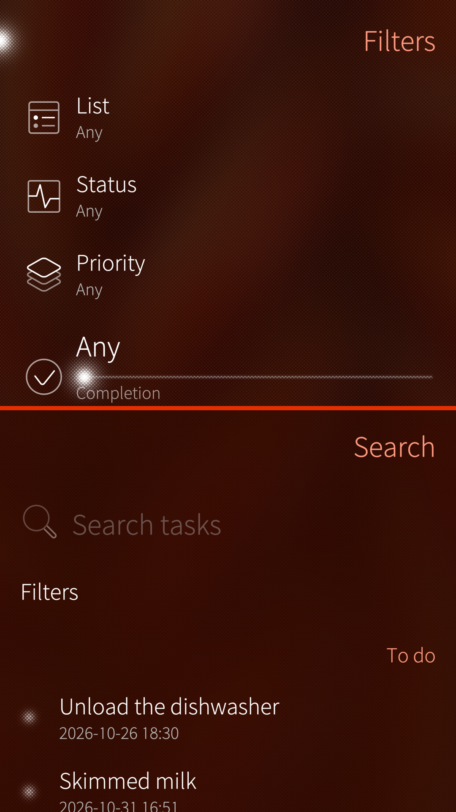
  </a>
  <figcaption style="flex-basis: 100%; font-size: 0.85em; color: #666; text-align: center; margin-top: 0.5em;">
    Custom filters in Askare
  </figcaption>
</figure>

That’s why Askare's search lets you filter results and save them as a named custom view. Research on the *IKEA effect* shows that people value things more when they help build them[^4] — so why not let users shape their own corner of the app?

This also solved a subtle navigation problem. Search opens on a separate page (signaling that it queries across all task lists rather than just the active view), and my first instinct was to put filters in an `AttachedPage`. But filters don't switch the underlying content, they refine what's already on screen.

Sailfish's `Drawer` component was a much better fit. It pushes the page content down (or aside) so you can preview filter changes live, avoiding the clunky back-and-forth navigation an `AttachedPage` would have required.

### Purposeful motion and breathing room

Visual restraint matters just as much inside a single screen. Animations are fun, but gratuitous motion quickly gets overwhelming. Used thoughtfully, though, animation explains what is happening on screen, showing that content extends past the edge, or reassuring the user that disappearing controls were tucked away intentionally rather than broken by a layout bug.

In Lappu, animations serve two specific purposes:

<figure style="display: flex; flex-wrap: wrap; justify-content: center; gap: 10px; margin: 1.5em auto; width: 100%;">
  <video controls style="flex: 1 1 220px; max-width: 280px; width: 100%; height: auto; display: block;">
    <source src="../../../assets/posts/2026/11/lappu-new-note.mp4" type="video/mp4">
    Your browser does not support the video tag.
  </video>
  <video controls style="flex: 1 1 220px; max-width: 280px; width: 100%; height: auto; display: block;">
    <source src="../../../assets/posts/2026/11/lappu-column.mp4" type="video/mp4">
    Your browser does not support the video tag.
  </video>
  <figcaption style="flex-basis: 100%; font-size: 0.85em; color: #666; text-align: center; margin-top: 0.5em;">
    Lappu animations for new notes and horizontal scrolling
  </figcaption>
</figure>

- **Reclaiming screen space:** When the on-screen keyboard is open in the editor, marking a note as a favorite or changing its category isn't the immediate priority. Gently animating those controls out of the way preserves *spatial continuity* and frees up vertical room for writing without jarring the eye.
- **Signaling scrollability:** Acting as a *visual signifier*[^5] that wide elements like tables or code blocks can be scrolled horizontally, and keeping the formatting toolbar on a single line while subtly showing that more tools sit off-screen.

## What I’m taking with me

AI can be a tremendous help (as with any tool, the outcome depends on the hand guiding it) but it still lags behind when it comes to human interaction nuances (and let’s hope it stays that way). If you are an experienced developer curious about Sailfish OS, LLMs can now take care of the heavy backend lifting and boilerplate, freeing you to focus deeply on how the app actually feels to use.

My own journey in AI-assisted development has only just begun, and I’m no seasoned UI guru handing down a manifesto. Still, if I had to distill what I’ve learned so far into a few takeaways:
- **Scaffold -> UI mockup -> Backend -> Test, test, test.** No LLM can substitute running your project on a real device to feel how it behaves in your hand.
- **Don't design in a vacuum.** You are the worst tester for your own app — the *curse of knowledge*[^6] makes it impossible to see your UI with fresh eyes.. Even if you're a great coder, think twice before doing UX completely alone. If you have friends, put them to work.
- **Trust your own judgment.** You wouldn’t let a hammer choose the nail, would you?

---

[^1]: [Dark pattern - Wikipedia](https://en.wikipedia.org/wiki/Dark_pattern)
[^2]: [Mental models - Interaction Design Foundation](https://ixdf.org/literature/book/the-glossary-of-human-computer-interaction/mental-models)
[^3]: [Signal-to-Noise Ratio - Nielsen Norman Group](https://www.nngroup.com/articles/signal-noise-ratio/)
[^4]: [The IKEA effect: When labor leads to love - Journal of Consumer Psychology](https://www.sciencedirect.com/science/article/abs/pii/S1057740811000829)
[^5]: [Signifiers - Interaction Design Foundation](https://ixdf.org/literature/topics/signifiers)
[^6]: [The Curse of Knowledge - Wikipedia](https://en.wikipedia.org/wiki/Curse_of_knowledge)

[guidelines]: https://sailfishos.org/design/
[common pitfalls page]: https://sailfishos.org/develop/docs/silica/sailfish-application-pitfalls.html/
[display density]: /sailfish-os-how-to-display-more-content